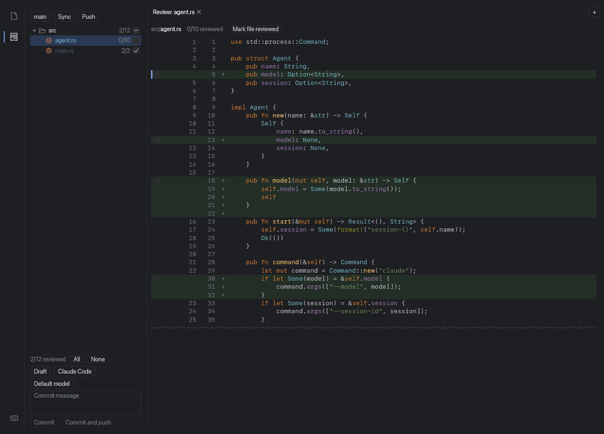

<p align="center">
  
</p>

<h1 align="center">Shepherd</h1>

<p align="center">
  <strong>An editor for the age of agents.</strong><br>
  They write the code. You steer, review, fix and ship.
</p>

<p align="center">
  <a href="https://github.com/rasmusraasuke/shepherd/actions/workflows/ci.yml"></a>
  <a href="LICENSE"></a>
  
  
  
</p>

<br>

Most editors were designed for a world where you type every line. Shepherd is designed for
the world that is arriving: agents do the writing, and the work becomes steering, reading and
deciding.

It is a native desktop editor built around that loop.

<p align="center">
  
</p>

<p align="center">
  <sub>Reviewing an agent's change. The marks are git's staging area.</sub>
</p>

- **The review is the point.** Changed files as a tree with their progress, diffs
  highlighted down to the words that changed, comments on the lines they are about. The
  review is the file, and the file can be edited right there in the diff.
- **Reviewed means staged.** Marking a change reviewed stages it, line by line if you like.
  There is no second place where review state lives; git is the state.
- **Agents are first-class.** Claude Code and Opencode run in Agent tabs of their own, with
  an agent and model chosen per session. Review comments, quick chat and everything else the
  editor hands over go there, never to a shell.
- **Everything is a tab.** Files, terminals, reviews and agents open side by side, stack,
  drag between windows, and come back after a restart.
- **Quiet by design.** No toolbar and no status bar. One calm palette in dark and light, the
  platform's fonts, and the code taking the rest.

The full list is in [FEATURES.md](FEATURES.md). The road ahead is in [PLAN.md](PLAN.md).

## Install

Shepherd is a native app for macOS 12 or newer, on Apple Silicon or Intel, and for Linux on
x86_64.

### macOS

1. Download the [latest release](https://github.com/rasmusraasuke/shepherd/releases/latest).
2. Drag `Shepherd.app` into Applications.
3. The build is signed ad hoc, so the first launch is a right-click on the app and *Open*,
   or once from a terminal:
   ```
   xattr -dr com.apple.quarantine /Applications/Shepherd.app
   ```

Or build it from the source:

```sh
git clone https://github.com/rasmusraasuke/shepherd.git
cd shepherd
./scripts/bundle.sh --universal --install --link
```

That builds `Shepherd.app`, installs it and links `shepherd` into `~/.local/bin`. Add
`--zip` to also produce the release zip.

### Linux

Download the Linux tarball from the [latest release](https://github.com/rasmusraasuke/shepherd/releases/latest),
then:

```sh
tar -xzf Shepherd-<version>-linux-x86_64.tar.gz
cd Shepherd-<version>-linux-x86_64
./install.sh
```

`install.sh` puts `shepherd` in `~/.local/bin`, with the icon and the desktop entry under
`~/.local/share`. Add `~/.local/bin` to `PATH` if it is not there, or run `./shepherd` from
the unpacked directory. The build is made on Ubuntu 22.04 and needs X11 or Wayland, with
Vulkan or OpenGL.

Build it from the source with `./scripts/bundle-linux.sh`, which makes the tarball in `dist/`.

The icon is `assets/icon.png`.

## Open a project

```sh
shepherd ~/code/your-project
```

Without a path it opens the current directory, or the repository it opened last, so it can
also be started from Spotlight or the Dock. The path must be inside a git repository.

A few keys to start with:

- `⌘P` opens a file by name, `⇧⇧` searches the project
- `⌃⌃` chats with an agent, `⌘T` opens a terminal
- `⌘/` shows every shortcut, the version, and a switch between the bundled and the system's
  fonts

## Agents

Shepherd works with **Claude Code** and **Opencode**, found on the `PATH`. Each Agent tab is a
real session that survives a restart, with the model chosen when it starts. The commit
message can be drafted by an agent of its own, in the background, so the model that writes
the message need not be the model that does the work.

Agents can see what you see. [`shepherd ctl`](FEATURES.md#agents-in-the-loop) gives them the
open file and selection, your review comments, what is staged, and the terminals; it also lets
them show you files and changes.

## Updates

When it starts, Shepherd asks GitHub for the latest release. A newer one downloads in the
background: on macOS a bar above the editor offers to restart into it, on Linux it offers to
show the download. The version is under `⌘/`, next to a check for updates.

Shepherd also watches the binary it was started from. When you rebuild it locally, the bar
offers to restart into the new build, and the tabs, splits and windows come back as they were.

The repository is public, so no token is needed.

## Development

```sh
cargo run --release -- path/to/repository
cargo test
cargo clippy --all-targets -- -D warnings
cargo fmt --check
```

CI runs the same three on macOS and Linux, on every push to `main` and on pull requests.

<details>
<summary>Releasing</summary>

Change the version in `Cargo.toml`, commit, then tag and push:

```sh
git tag v0.2.0
git push origin main v0.2.0
```

The tag starts `.github/workflows/release.yml`, which builds the macOS app and the Linux
tarball, checks the tag against `Cargo.toml` and publishes
`Shepherd-<version>-macos-universal.zip` and `Shepherd-<version>-linux-x86_64.tar.gz` with
the release notes. A tag with a hyphen, such as `v0.2.0-rc.1`, is published as a pre-release
and is not offered as an update.

</details>

## License

MIT © 2026 Rasmus Raasuke. See [LICENSE](LICENSE).

Shepherd embeds IBM Plex Sans and Lilex (under the SIL Open Font License) and DejaVu Sans
(under the Bitstream Vera license). Their licenses are in [assets/fonts](assets/fonts).
